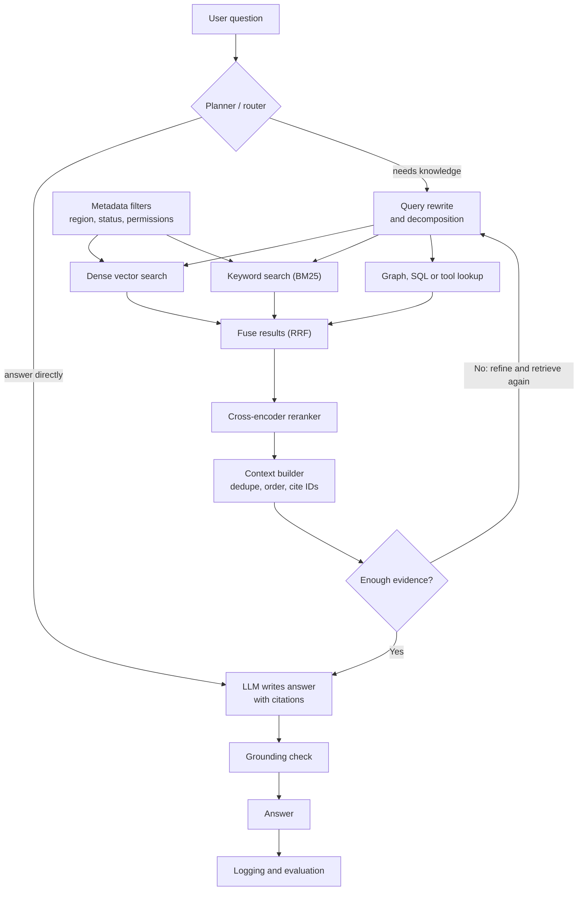

# Modern RAG (2026)

Basic RAG is "embed, take the top few chunks, paste into the prompt." Modern RAG keeps the same idea but adds steps that fix its usual failures: missed keywords, stale or wrong-region documents, questions that need several lookups, and answers nobody checks.

## 1. Basic vs modern

| Stage | Basic RAG (2023 style) | Modern RAG |
|-------|------------------------|------------|
| Chunking | Fixed-size pieces | Section-aware chunks; often a short context note added to each chunk (contextual retrieval) |
| Metadata | Rarely used | Region, version, status, permissions stored and filtered on |
| Query | Used as typed | Rewritten, expanded, or split into sub-questions |
| Retrieval | Vector similarity only | Hybrid: vector plus keyword (BM25), results fused (for example with RRF) |
| Ranking | Similarity score | Cross-encoder reranker reads query and chunk together |
| Control flow | One retrieval, then answer | A planner decides whether to retrieve, and can retrieve again (agentic RAG) |
| Other sources | Vector store only | Also graphs, SQL, APIs, other tools |
| Output | Free text | Cited answer, often with a grounding check |
| Evaluation | Looking at a few answers | Separate retrieval metrics and answer metrics, logged and tracked |

## 2. Diagram

## 3. The building blocks

**Contextual chunking.** Keep section headings in each chunk and optionally add a one-sentence summary of the parent document before embedding. A chunk that says "up to 10 days roll forward" is ambiguous; one that starts "India - Chennai payroll leave policy 2026" is not.

**Query rewriting and decomposition.** An LLM rewrites a vague or conversational question into a clean search query, or splits a complex one into parts ("what is the global rule?" and "is there a Chennai exception?").

**Hybrid retrieval.** Dense vectors capture meaning; keyword search catches exact terms such as "Chennai" or a policy code. Run both and merge the lists, for example with Reciprocal Rank Fusion.

**Metadata filtering.** Cheap and powerful: restrict by `status`, region, date, or the user's access rights before ranking.

**Reranking.** Retrieve more candidates (say 30 to 50), then let a cross-encoder reorder them and keep the best 3 to 5. It reads the query and each chunk together, so it is more accurate than similarity alone, at the cost of extra latency.

**Agentic loop.** The model decides whether to search, what to search, and whether the evidence is enough. This helps multi-hop questions, at the price of more latency and cost.

**GraphRAG.** Builds a knowledge graph of entities and relations at index time. Useful when answers depend on relationships across many documents.

**Long context as a partner.** Large context windows do not replace retrieval, but they let you pass more of the retrieved material. Retrieval picks the right material; the long context holds it.

**Grounding check and evaluation.** Verify that each claim is supported by a cited chunk. Measure retrieval (was the right chunk found: recall@k, MRR, nDCG) separately from generation (is the answer faithful and complete).

## 4. Applied to the Chennai leave question

| Problem in the basic pipeline | Modern fix |
|-------------------------------|------------|
| Old 2024 and 2025 chunks returned | `status = current` metadata filter |
| US and global rules outrank the Chennai rule | Region filter plus keyword match on "Chennai" (hybrid) |
| Chennai chunk worded differently ("roll forward") | Reranker, and heading text kept in each chunk |
| Answer needs the Chennai rule and the global fallback | Query decomposition or an agent that retrieves twice |
| Bot sounds confident without evidence | Grounding check and "say so if context does not answer" instruction |
| Nobody notices regressions | Fixed test questions with expected chunk IDs, run after every change |

The demo script in `03-rag_chroma_demo.py` already implements the metadata filter and keyword condition. Reranking, query rewriting, and agent loops are the next steps to add.

## 5. Which pattern to choose

| Situation | Start with |
|-----------|------------|
| FAQ bot, small stable corpus | Basic RAG, or put the document in the prompt |
| Mixed queries, exact terms matter | Hybrid retrieval plus metadata filters |
| Precision matters, noisy results | Add a reranker |
| Multi-step or multi-document questions | Agentic RAG with query decomposition |
| Relationship-heavy data (people, systems, dependencies) | GraphRAG |
| Strict latency or cost limits | Keep it simple; cache, and rerank fewer candidates |

Add one technique at a time and measure it. Each step adds latency and cost, and some pipelines reach several seconds end to end.

## 6. Notes on the claims

- This summary is based on 2026 articles and a few papers. Many are practitioner blogs or vendor pages, so their numbers (latency, accuracy gains, cost) are indicative, not settled.
- Reported gains from techniques such as contextual retrieval and agentic RAG depend on the dataset. Test on your own questions.
- Tool and model names change quickly; check current documentation before choosing a reranker or framework.
