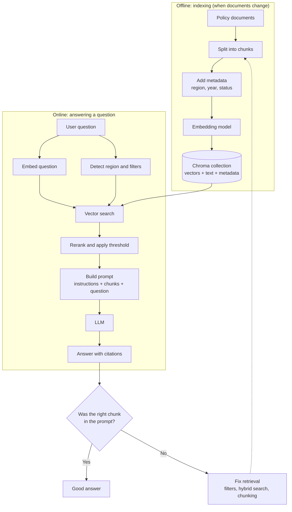

# RAG Flow Diagram

The flow for the Chennai leave scenario, from indexing to answer.

## How to read it

| Part | What happens | Where it appears in the files |
|------|--------------|-------------------------------|
| Offline | Documents are split, tagged with metadata, embedded, and stored | `03-rag_chroma_demo.py`, `build_collection()` |
| Detect region and filters | The question's region (for example "Chennai") becomes a metadata filter | `detect_region()` and `improved()` |
| Vector search | Chroma returns the nearest chunks that pass the filters | `collection.query(...)` |
| Rerank and threshold | Optional step to re-score candidates and drop weak matches | Not in the demo; see the problem statement |
| Build prompt | Chunks and question are combined with instructions | `build_prompt()` |
| Retrieval check | Confirm the expected chunk (`IN-2026`) is in the context before blaming the LLM | `show()` prints it |

## Viewing the diagram

- **GitHub, GitLab, Obsidian:** the diagram renders directly in this file.
- **VS Code:** install a Mermaid preview extension for Markdown.
- **Anywhere else:** paste the code between the backticks into [mermaid.live](https://mermaid.live).

## Related files

- [01-problem-statement.md](./problem-statement.md)
- [02-chroma-how-to.md](./how-to-use-chroma.md)
- [03-rag_chroma_demo.py](./rag-with-chroma.py)
